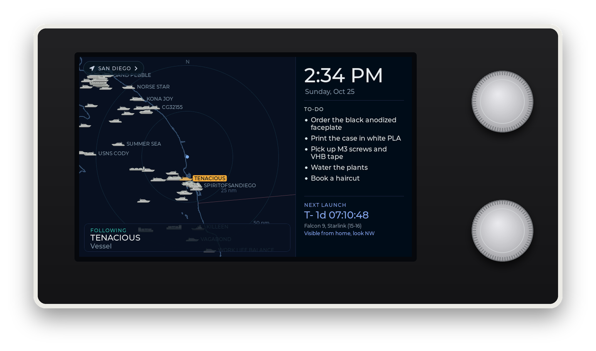
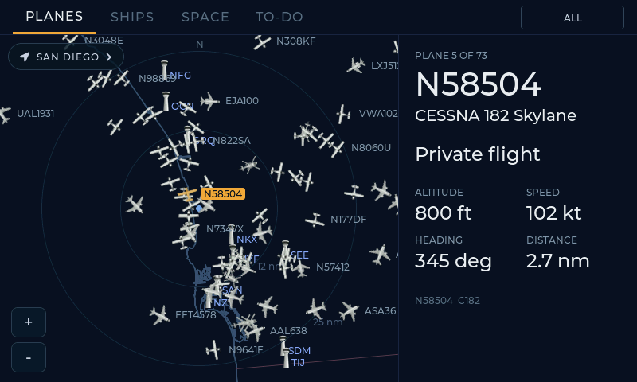
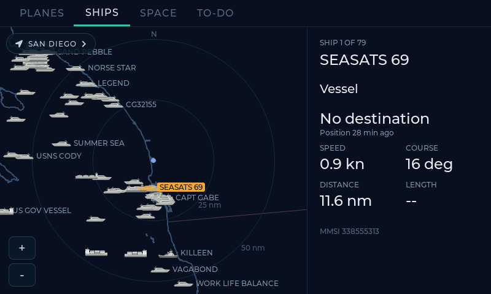
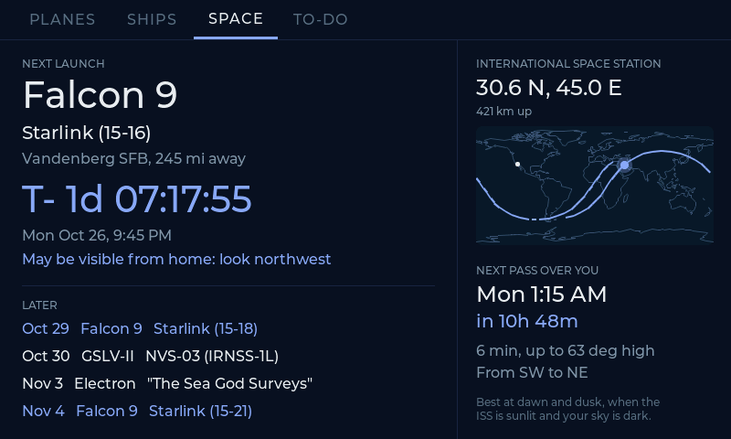
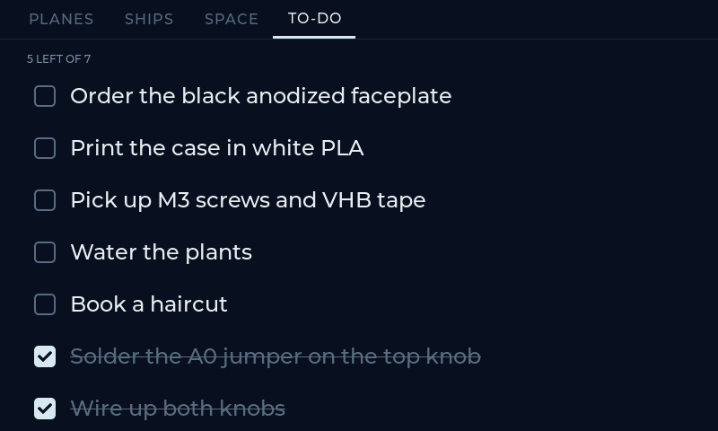
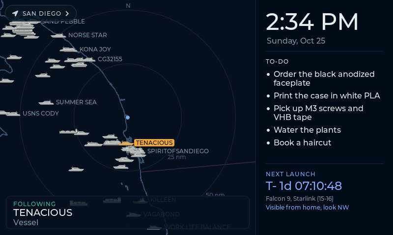
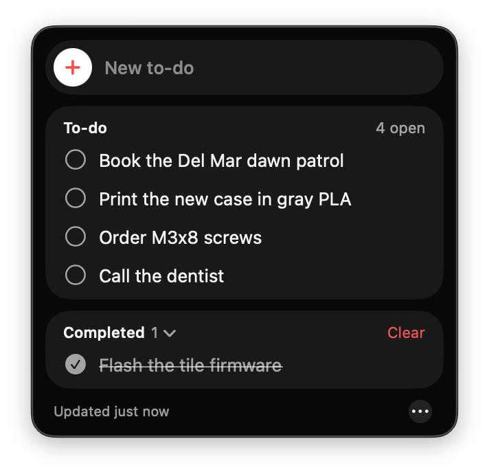
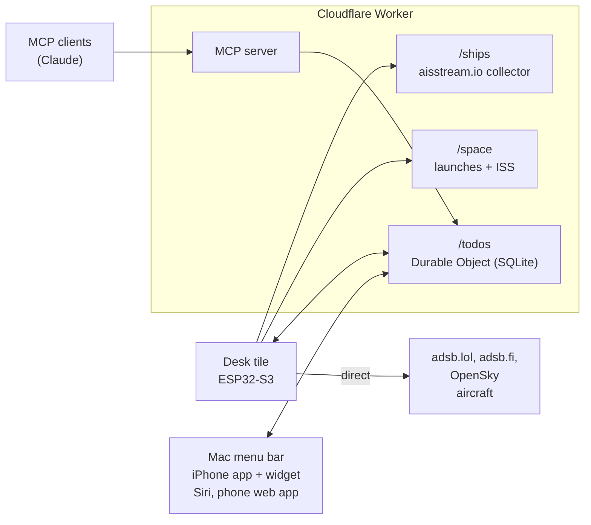

# SkyTile

A little desk display that shows the planes overhead, the ships offshore, the next rocket
launch and my to-do list. It's a 5" ESP32-S3 touchscreen in a 3D-printed wedge with a
black anodized aluminum face and two clicky knobs. To-dos can be pushed to it from anything
that speaks MCP (Claude, for one), Siri, the Mac menu bar or an iPhone widget.

Inspired by [theskytile.com](https://theskytile.com). Built from scratch: firmware, case,
backend and clients.

<p align="center">
  
  <br><sub>Mockup of the finished tile, with a real screenshot from the device. The case is still being printed.</sub>
</p>

## Four modes

<table>
  <tr>
    <td width="50%"></td>
    <td width="50%"></td>
  </tr>
  <tr>
    <td><b>Planes.</b> Live aircraft from <a href="https://adsb.lol">adsb.lol</a>, drawn by class: airliner, fighter, military cargo, bizjet, prop, helicopter. Tap one for its flight, type, altitude, speed and route. Filters for military and interesting traffic.</td>
    <td><b>Ships.</b> AIS positions from <a href="https://aisstream.io">aisstream.io</a>, collected by a Cloudflare Worker. Icons by vessel type (cargo, tanker, navy, cruise, sailboat...), with destination, speed and course.</td>
  </tr>
  <tr>
    <td></td>
    <td></td>
  </tr>
  <tr>
    <td><b>Space.</b> Countdown to the next launch (Launch Library 2) with a hint when a Vandenberg launch may be visible from home, plus the ISS ground track and the next pass overhead.</td>
    <td><b>To-do.</b> A shared list. Tap to check items off. Push items in over MCP (Claude), Siri, the Mac menu bar, an iPhone widget or a phone web app: they all edit the same list.</td>
  </tr>
</table>

### Sleep dashboard

After 30 seconds untouched the tile turns into a clock: the map keeps running on the left
(following a moving ship or plane), with the time, open to-dos and the next launch on the right.

<p align="center"></p>

### To-dos from the Mac menu bar

The same list lives in the menu bar (a [SwiftBar](https://swiftbar.app) plugin): the open
count up top, click an item to check it off, Option-Cmd-T to add one. There's also an
iPhone app with home and lock screen widgets, a Siri Shortcut, and a phone web app.
Setup is in [docs/todos.md](docs/todos.md).

<p align="center">
  
  <br><sub>Drawn from the plugin's actual menu output.</sub>
</p>

### Hotspots

The map cycles through busy waterways and ports: San Diego, Strait of Hormuz, Persian Gulf,
Dover Strait, Rotterdam, Singapore Strait, Hong Kong, Taiwan Strait, Tokyo Bay, Puget Sound,
SF Bay and New York Harbor, each with its own airports. Tap the place name (or press the top
knob) for the next one. Tap HOME, or hold the top knob, to jump back. After 3 minutes untouched it goes home
by itself.

## Knobs

Two Adafruit I2C rotary encoders sit to the right of the screen.

| | Turn | Press | Hold |
|---|---|---|---|
| **Top knob** | Switch mode | Next location | Home (San Diego) |
| **Bottom knob** | Move through planes, ships, launches or to-dos | Open details, or check off a to-do | Add or remove a favorite |

Touch works everywhere too: tap to select, pinch or use the buttons to zoom, drag to pan.
The planes filter (All, Military, Interesting, Favorites) is the chip in the top bar.

## How it works



- **Planes** come straight from the tile, because the free ADS-B feeds rate-limit Cloudflare's
  IPs. It tries adsb.lol, then adsb.fi, then OpenSky, and uses the first that answers. Each
  feed's daily cap is budgeted (adsb.lol allows 500 requests a day), and a feed that answers
  429 is skipped for 10 minutes. Planes refresh every 10 s on the Planes screen and every 5 min
  on the sleep dashboard. Routes come from Flightradar24's live map feed, falling back to adsb.lol's route data and adsbdb.com; the Worker
  checks both against where the plane is and only returns a leg it's actually flying.
- **Ships:** aisstream.io is a WebSocket firehose, too heavy for the ESP32. The Worker keeps
  one connection open for every hotspot asked for in the last 15 minutes and serves a
  compact JSON list.
- **Space:** Launch Library 2 with RocketLaunch.live as a fallback, and the ISS orbit
  (TLE) from CelesTrak. The Worker works out the ISS ground track and the next good pass
  over home, so the tile only draws them.
- **To-dos:** one Durable Object is the single source of truth. The Worker exposes it as an
  MCP server (connected to Claude, so "add pick up M3 screws to my tile" works), a REST API
  for the Mac menu bar, iPhone app, widget and Siri Shortcut, and a small web app. Details in
  [docs/todos.md](docs/todos.md).

## Hardware

| Part | Notes |
|---|---|
| [Elecrow CrowPanel Advance 5.0" HMI](https://www.elecrow.com/) | ESP32-S3, 800x480 IPS, capacitive touch, WiFi. Its I2C port feeds the knobs. |
| 2x [Adafruit I2C STEMMA QT Rotary Encoder #5880](https://www.adafruit.com/product/5880) | Seesaw firmware, push switch. Bridge the **A0** jumper on the top one so it moves to address 0x37 (changing the address in software doesn't stick). |
| [Adafruit #4209](https://www.adafruit.com/product/4209) + [#4210](https://www.adafruit.com/product/4210) | QT-to-header cable (meets the panel's Grove cable) and a short QT cable between the knobs. |
| 2x 20 mm aluminum knobs, M7x0.75 nuts | Set-screw knobs for the 6 mm D-shaft. |
| Right-angle USB-C cable | The panel's USB-C faces backward, so a straight plug hits the base. |
| Faceplate | 1.6 mm black anodized 5052 aluminum, laser cut from [`case/skytile_faceplate.dxf`](case/skytile_faceplate.dxf), held with 3M VHB tape. |
| Case | Two printed parts in white PLA: [`skytile_shell.stl`](case/skytile_shell.stl) (print face down) and [`skytile_back.stl`](case/skytile_back.stl). GitHub shows both in 3D. |

The case is parametric CadQuery ([`case/skytile_case.py`](case/skytile_case.py)): 15 degree
lean, 171.6 x 92.3 mm face, knobs 42 mm apart.

## Repo layout

| Path | What |
|---|---|
| [`firmware/skytile/`](firmware/skytile) | PlatformIO project: LVGL UI, data fetching, knobs, OTA updates |
| [`worker/`](worker) | Cloudflare Worker (TypeScript): ships, space, to-dos, MCP server |
| [`clients/`](clients) | SwiftBar menu bar plugin, SwiftUI iPhone app + widget |
| [`case/`](case) | CadQuery source, STL / STEP / DXF exports |
| [`design/`](design) | Vehicle icons (SVG), knob simulator, parts list |

## Build it

**Worker**

```sh
cd worker
npm install
npm test
npx wrangler deploy
npx wrangler secret put TILE_KEY     # also MCP_SECRET, WEB_SECRET, API_TOKEN, AISSTREAM_KEY
```

**Firmware** (PlatformIO 6.1)

```sh
cd firmware/skytile
cp include/secrets.example.h include/secrets.h   # WiFi, home location, Worker URL, keys
pio run -t upload                                 # first time over USB
tools/ota.sh                                      # after that, over WiFi
```

The ESP-IDF settings in `platformio.ini` matter: the RGB panel needs PSRAM bandwidth that
WiFi also wants, and the defaults make the picture shift. See the notes in
[`CLAUDE.md`](CLAUDE.md) before changing them.

**To-do clients:** setup for the Mac menu bar, iPhone app and web app is in
[docs/todos.md](docs/todos.md).

## Credits

Data from [adsb.lol](https://adsb.lol), [adsb.fi](https://adsb.fi), [OpenSky Network](https://opensky-network.org), [adsbdb](https://www.adsbdb.com), [aisstream.io](https://aisstream.io),
[Launch Library 2](https://thespacedevs.com/llapi), [RocketLaunch.live](https://www.rocketlaunch.live),
[CelesTrak](https://celestrak.org). Airports from [OurAirports](https://ourairports.com). Coastlines from [Natural Earth](https://www.naturalearthdata.com)
and [OpenStreetMap](https://www.openstreetmap.org/copyright). UI built with [LVGL](https://lvgl.io).
